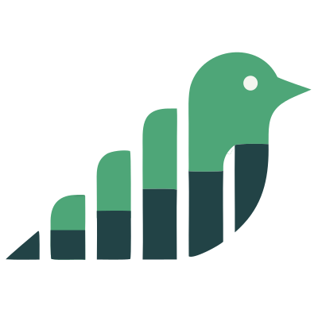

<p align="center"></p>

# Larkpulse MCP server

Run your social media from the AI assistant you already use. [Larkpulse](https://www.larkpulse.com) connects Claude, ChatGPT, Perplexity, Cursor and command-line agents to your social channels, so they can plan, write, design, schedule and publish posts, read your analytics and help you reply to comments.

**Docs:** [larkpulse.com/mcp](https://www.larkpulse.com/mcp) · **Guide:** [How to use the Larkpulse MCP](https://www.larkpulse.com/help/larkpulse-mcp) · **Support:** [support@larkpulse.com](mailto:support@larkpulse.com)

> This repository holds the public docs and client manifests. The Larkpulse MCP server is a hosted service, so there is nothing to install or run, and its source code is not published here.

## What it does

- **Publish everywhere:** draft, schedule, queue or publish to Facebook, Instagram, LinkedIn, Threads, X, YouTube, TikTok and Pinterest in one call.
- **Write in your voice:** generate, improve and adapt posts using your Larkpulse Brain, personas and playbook.
- **Create visuals:** generate AI images and 3 to 9 slide carousels with your styles and brand kits.
- **Learn what works:** analytics for each account or the whole workspace, including your top posts.
- **Reply to your audience:** read your inbox, draft on-brand replies and post the ones you approve.

## Connection details

| | |
|---|---|
| Server URL | `https://app.larkpulse.com/api/mcp` |
| Transport | Streamable HTTP |
| Authentication | OAuth 2.1 with PKCE and dynamic client registration. Sign in once with Larkpulse, no API keys. |
| Plan | A paid Larkpulse plan: Pro or above (Pro includes 1,000 MCP calls a month, Business 3,000). |

## Setup

Generic config for clients that accept `mcpServers`:

```json
{
  "mcpServers": {
    "larkpulse": { "url": "https://app.larkpulse.com/api/mcp" }
  }
}
```

**Claude:** Settings → Connectors → Add custom connector → paste the server URL → Connect, then sign in with Larkpulse and approve.

**Claude Code:**

```bash
claude mcp add --transport http larkpulse https://app.larkpulse.com/api/mcp
```

**ChatGPT:** Settings → Apps → Advanced settings → turn on Developer mode. Click Create app, paste the server URL, set Authentication to OAuth, create the app, then click Sign in with Larkpulse.

**Perplexity:** Settings → Connectors → add a custom MCP connector with the server URL and authorize with Larkpulse.

**Cursor:** Settings → MCP → Add new MCP server (or edit `~/.cursor/mcp.json`) and paste the generic config above. This repo is also a Cursor plugin (`.cursor-plugin/plugin.json` + `mcp.json`).

**VS Code:** add to `.vscode/mcp.json`:

```json
{
  "servers": {
    "larkpulse": { "type": "http", "url": "https://app.larkpulse.com/api/mcp" }
  }
}
```

**Gemini CLI / Antigravity CLI:** this repo is an extension (`gemini-extension.json`):

```bash
gemini extensions install https://github.com/larkpulse/larkpulse-mcp
```

**OpenClaw** (interactive terminal, sign-in opens a browser):

```bash
openclaw mcp add larkpulse --url https://app.larkpulse.com/api/mcp --transport streamable-http --auth oauth
openclaw mcp doctor larkpulse --probe
openclaw mcp reload
```

**Hermes** (interactive terminal):

```bash
hermes mcp add larkpulse --url https://app.larkpulse.com/api/mcp --auth oauth
```

Then run `/reload-mcp` in the agent and confirm with `hermes mcp list`.

**stdio-only clients** can use the `mcp-remote` bridge:

```json
{
  "mcpServers": {
    "larkpulse": { "command": "npx", "args": ["-y", "mcp-remote", "https://app.larkpulse.com/api/mcp"] }
  }
}
```

AI agents can follow [`llms-install.md`](llms-install.md) and the workflow guide in [`skills/larkpulse/SKILL.md`](skills/larkpulse/SKILL.md).

## Example requests

- "What were my best posts this month, and what do they have in common?"
- "Write a LinkedIn post about our launch, make an image for it and schedule it for Tuesday at 9am."
- "Turn this post into a carousel and save it as a draft."
- "Show me new comments and draft replies."

## Tools

Every tool carries MCP annotations (`readOnlyHint`, `destructiveHint`, `idempotentHint`, `openWorldHint`) so your assistant knows which tools only read, which change your Larkpulse data and which act on a social platform. Full input schemas are in [`tools.json`](tools.json).

### Workspaces and channels

| Tool | What it does | Access |
|---|---|---|
| `list_workspaces` | Workspaces you can access and your role in each. | Read |
| `list_accounts` | Connected social accounts, with each account's character limit. | Read |
| `list_pinterest_boards` | Boards for a connected Pinterest account. | Read |
| `list_content_categories` | Content category queues and their posting slots. | Read |
| `list_personas` | Personas for AI writing. | Read |

### Analytics and calendar

| Tool | What it does | Access |
|---|---|---|
| `get_analytics` | Metrics for one account or the whole workspace, including your top posts. | Read |
| `get_calendar` | Drafts, scheduled and published posts over a date range. | Read |
| `get_post` | One post's publish status, errors and links for each account. | Read |

### Brain

| Tool | What it does | Access |
|---|---|---|
| `list_sources` | Uploaded source documents and their insight counts. | Read |
| `list_brain_insights` | Stories, facts, ideas and other insights from your Brain. | Read |
| `get_brain_insights` | Full text of selected insights. | Read |

### Writing with AI

| Tool | What it does | Access |
|---|---|---|
| `list_generate_models` | AI models and their credit cost. | Read |
| `generate_post` | Write post copy from a brief or Brain insights. Saves nothing. | Changes Larkpulse |
| `improve_post` | Polish your draft for each channel. Saves nothing. | Changes Larkpulse |
| `magic_adapt` | Adapt a post to other channels. Saves nothing. | Changes Larkpulse |
| `generate_first_comments` | Write follow-up comments for a post. Saves nothing. | Changes Larkpulse |

### Images and carousels

| Tool | What it does | Access |
|---|---|---|
| `list_image_options` | Image models, styles and brand kits. | Read |
| `generate_image` | Generate up to 4 AI images, saved to your Media Library. | Changes Larkpulse |
| `get_image` | Check an image job and get the finished images. | Changes Larkpulse |
| `list_carousel_options` | Carousel designs, your styles, brand kits and CTAs. | Read |
| `generate_carousel` | Create a 3 to 9 slide carousel from post text. | Changes Larkpulse |
| `get_carousel` | Check a carousel's progress and slides. | Read |
| `edit_carousel` | Change a carousel in plain language. | Changes Larkpulse |

### Media

| Tool | What it does | Access |
|---|---|---|
| `upload_media` | Add an image or video to your Media Library from a URL or chat attachment. | Changes Larkpulse |
| `create_media_upload` | Get a direct upload link for local files (command-line agents). | Changes Larkpulse |
| `finalize_media` | Save a file uploaded through a direct upload link. | Changes Larkpulse |

### Posting

| Tool | What it does | Access |
|---|---|---|
| `list_comment_ctas` | Saved calls to action you can add as a first comment. | Read |
| `save_draft` | Save a post as a draft in your calendar. | Changes Larkpulse |
| `schedule_post` | Schedule a post for a future time. | Acts on platform |
| `add_to_category` | Queue a post into a content category's next slot. | Acts on platform |
| `publish_post` | Publish a post now to one or more accounts. | Acts on platform |

### Inbox

| Tool | What it does | Access |
|---|---|---|
| `get_inbox` | Comments, replies and mentions on your posts. | Read |
| `draft_comment_reply` | Draft an on-brand reply for you to review. Posts nothing. | Changes Larkpulse |
| `reply_to_comment` | Post a reply you've approved. | Acts on platform |
| `moderate_comment` | Ignore, hide, unhide, approve or reject a comment. | Acts on platform |

## Prompts

| Prompt | What it does |
|---|---|
| `plan_week_of_posts` | Draft a week of posts from your Brain and save them as drafts for review. |
| `repurpose_to_channels` | Adapt one post to each connected channel. |
| `carousel_from_post` | Turn a post into an AI carousel and attach it to a draft. |
| `analytics_recap` | Summarise performance and your best posts, with ideas for what to post next. |
| `reply_to_comments` | Draft replies to new comments for you to approve. |

## Usage and AI credits

Each successful action counts as one MCP call against the workspace owner's monthly allowance. Checking a post, image or carousel is free, and failed calls are never counted. Writing and image tools also use AI credits, or your own OpenRouter or fal.ai keys. See [how MCP calls are counted](https://www.larkpulse.com/help/larkpulse-mcp).

## Security and privacy

- You sign in with Larkpulse and approve each assistant. It gets the same access you have in your workspaces, nothing more.
- Access tokens expire after an hour. Revoke any assistant in Larkpulse under Settings → Billing → Connected apps.
- Data your assistant reads is shared with that assistant's provider. See the [AI assistants section of the privacy policy](https://www.larkpulse.com/privacy-policy#ai-assistants) and the [terms of service](https://www.larkpulse.com/terms-of-service).

## Repository contents

| File | Purpose |
|---|---|
| `server.json` | [Official MCP Registry](https://registry.modelcontextprotocol.io) entry (`com.larkpulse/mcp`) |
| `tools.json` | Generated tool, prompt and resource manifest |
| `mcp.json`, `.cursor-plugin/plugin.json` | Cursor plugin |
| `gemini-extension.json` | Gemini CLI / Antigravity CLI extension |
| `llms-install.md` | Install steps for AI agents |
| `skills/larkpulse/` | Agent workflow guide (also served by the MCP server) |
| `assets/` | Logos |

## Support

Email [support@larkpulse.com](mailto:support@larkpulse.com) or use the [contact form](https://www.larkpulse.com/contact).

Last verified: 23 October 2026 · Server version 1.1.0
